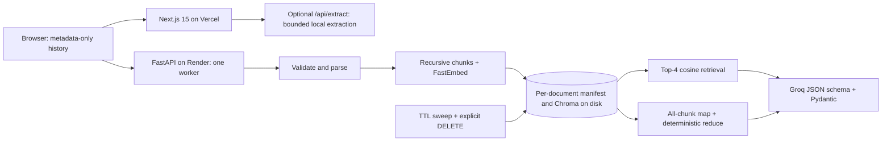

# ContractIQ

Explore property contracts through source-backed Q&A and a benefits/obligations scorecard. **Informational only, not legal advice.** Check findings against the original agreement and consult a qualified professional before making decisions.

Phase 0 establishes tested foundations. This is a bounded, single-worker prototype. Authentication and per-user isolation are planned for Phase 3. Anyone holding a document ID can read its metadata, query it, analyze it, or delete it. Use non-sensitive sample documents for a public demo.

## Phase 0 functionality

- Upload PDF, DOCX, UTF-8 TXT/MD or paste text. Default limits: 2 MiB, 60 PDF pages, 100,000 extracted characters, 120 chunks, 20 retained documents.
- LangChain recursive splitting (1,000 characters / 150 overlap), local ONNX FastEmbed `sentence-transformers/all-MiniLM-L6-v2`, per-document persisted Chroma with explicit cosine distance.
- Top-4 chat retrieval. Groq `openai/gpt-oss-20b` native structured output, validated with Pydantic including citation IDs. Source quotations and PDF page numbers appear in chat.
- Benefits analysis maps **every** chunk in bounded batches, checks quoted evidence, then deterministically merges duplicate party/kind/quotation findings. No keyword/top-five sampling or lossy LLM reduction. A failed batch fails the whole request; partial results are never reported as complete.
- All parties and findings remain visible. Significance scores (1–10) are model-generated, uncalibrated, and **not** fairness, risk, or enforceability measures. The old misleading fairness percentage is removed; the risk rubric remains Phase 1 work.
- Byte/type/size validation, archive expansion checks, limits before multipart parsing, explicit CORS origins, generated request IDs, bounded rate limits, sanitized errors, periodic document expiry/deletion.
- Components/hooks/lib, a runtime-validated typed API client, and metadata-only history with migration that removes old stored contract text and obsolete API keys.

## Architecture



The UI uploads once to FastAPI. `/api/extract` remains a standalone text-extraction fallback, not an alternative AI backend. Its output is never saved to browser storage by the app.

## Local setup

Use Node 22 and Python 3.12 (the Docker/CI version).

```bash
python -m venv .venv
# Windows PowerShell: .venv\Scripts\Activate.ps1
# macOS/Linux: source .venv/bin/activate
python -m pip install -r contractiq-backend/requirements-dev.txt
cd contractiq-backend
# Copy .env.example to .env and set GROQ_API_KEY.
uvicorn main:app --reload --port 8000
```

In another terminal, from the repository root:

```bash
npm ci
# Copy .env.example to .env.local.
npm run dev
```

Open `http://localhost:3000`. First ingestion downloads the embedding model unless cached. Unit/API tests require neither that download nor Groq credentials. Use one Uvicorn worker: locks, rate limits, and admission control are process-local.

## Verification

```bash
# Repository root
npm run lint
npm run typecheck
npm test
npm run build

# Activated Python environment, backend directory
cd contractiq-backend
python -m ruff check .
python -m mypy
python -m pytest -q
```

Tests cover whole-document map coverage, deduplication, invalid/truncated model outputs and bounded retries, unsupported quotations, failed batches, upload spoofing, archive bombs, streamed limits, CORS, request IDs, rate limits, TTL/restart/failure cleanup, API flow with mocked Groq, history migration/expiry, failed deletion, stale async results, citations, and fallback extraction. Real Chroma persistence/retrieval/deletion is tested with deterministic vectors. GitHub Actions runs backend lint/typecheck/tests and frontend lint/typecheck/tests/build.

No retrieval accuracy, faithfulness, latency p95, cost-per-document, or legal-accuracy metrics have been measured. Phase 2 must produce actual evaluation results; none are estimated here.

## Privacy and retention

1. Upload bodies are bounded and parsed transiently; framework spools close after processing. The app does not retain original PDF/DOCX files. OS temporary data can survive abrupt process/host crashes.
2. Extracted chunks/metadata are persisted in `DATA_DIR/documents/<uuid>/document.json`; embeddings persist in that document's `vectors/` Chroma directory. **This is disk persistence, not zero persistence.** Default TTL: one hour from ingestion start, including across restarts if the disk survives.
3. Expired IDs are rejected immediately. A startup sweep and a 60-second periodic sweep remove the entire directory. Explicit deletion removes access before unlinking files. Failed filesystem deletion is logged without content and retried; explicit DELETE does not claim success while removal is pending. Cleanup cannot run on a suspended/stopped host and resumes on startup. Deletion is not forensic secure erasure and does not control host backups.
4. Browser storage retains only IDs, filenames, character/chunk counts, and creation/expiry times. Filenames can themselves be sensitive. Chat, quotations, scorecards, and pasted text stay in current-session memory. Loading this version removes old full-text history and HF/Groq keys; browsers that never load it cannot be migrated remotely.
5. Groq receives retrieved excerpts for chat, every chunk for benefits, the question, and up to six history messages. **No PII redaction yet.** App TTL cannot remove provider-held data; review [Groq's data policy](https://console.groq.com/docs/your-data). The layout requests Google Fonts. Chroma anonymized telemetry is disabled; document bodies/provider responses are not logged by the app.
6. Legacy `chroma_db/` and `uploads/` folders have no TTL manifests and are not opened by this version. Before reusing an old disk, stop the old server and remove those legacy backend directories after verifying their resolved paths. Re-upload documents. The new sweeper only deletes its own UUID directories.

Delete-all removes server documents represented by the last 10 remembered entries. Older browser-history entries remain subject to their original backend TTL.

## Render + Vercel deployment

Keep the two-service deployment. On Render use Docker with context `contractiq-backend` or the existing blueprint, set `GROQ_API_KEY`, and set `CORS_ORIGINS` to the exact frontend origin. Add preview origins individually; wildcard subdomains are rejected. Set Vercel's `NEXT_PUBLIC_RAG_API_URL` to the backend HTTPS URL. Keys belong only on the backend. Deploy frontend and backend together because `/benefits` now returns structured `items` instead of a JSON string.

Docker preloads the embedding model and starts one worker. `/health` is liveness only, not provider/model readiness. Configure Uvicorn proxy trust only for known proxy addresses; do not set `FORWARDED_ALLOW_IPS=*` on an exposed origin. Until trusted proxy addresses are configured, clients behind the same proxy may share a rate-limit bucket. CORS does not authenticate non-browser clients.

Free/low-memory suitability is a goal, **not a measured guarantee**. FastEmbed and HNSW use one thread, and only one upload/chat/analysis job is admitted at a time; concurrent work gets 503. Chroma/ONNX and parsing can still exceed a small tier's memory. Start with smaller `MAX_TEXT_CHARS`, `MAX_CHUNKS`, and `MAX_DOCUMENTS`; use a larger-memory tier if needed. No PyTorch or sentence-transformers runtime is loaded, but Chroma has substantial transitive dependencies.

Whole-document analysis can exceed free provider quotas or the 240-second budget. Failures are explicit rather than silently dropping chunks. Reduce document size; raise budgets only after checking hosting/provider limits. Browser timeout: 300 seconds. No latency or memory numbers are asserted without measurements.

## Limitations and future phases

- No auth, per-user isolation, distributed limiter, queue, cloud storage, multi-worker support, PII redaction, OCR, hybrid retrieval, CUAD classifier, SSE, or legal rule pack yet. Next.js extraction uses a global per-instance budget, not a distributed Vercel limiter.
- Format checks are not antivirus or a full parser sandbox. PDFs can still be resource-intensive. Scans return an OCR-needed error. Backend DOCX extraction reads main paragraphs/tables, not separate footnotes/headers/text boxes.
- Supported quotations and citation IDs cannot establish truth or correct legal interpretation. Coverage counts processed chunks, not extraction recall. Case/whitespace-normalized exact dedupe can retain paraphrases and party aliases.
- Source quotations and chat page metadata work; exact PDF offsets/highlights remain Phase 1.
- Next.js is upgraded from 14 to 15.5.27 with React 19 because the old line is affected by an unpatched Windows RCE advisory. Render/Vercel and the App Router structure remain unchanged. [Maintainer advisory](https://github.com/vercel/next.js/security/advisories/GHSA-p293-qw3h-jr36). ESLint 8 and Tailwind 3 still use older tooling; remaining advisories are documented in the verification notes.

See [Phase 0 notes](docs/phase-0.md) for manual checks, API changes, and commit guidance, and [verification results](docs/phase-0-verification.md) for observed checks, dependency advisories, and unverified deployment steps. Later phases start only on request.
