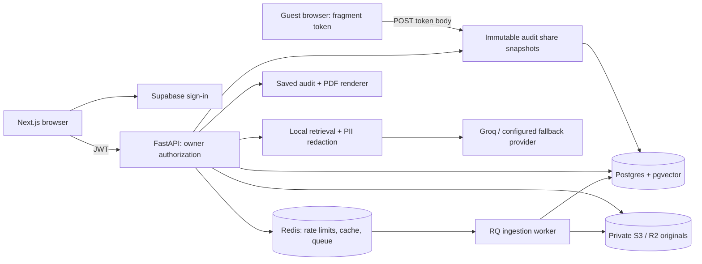
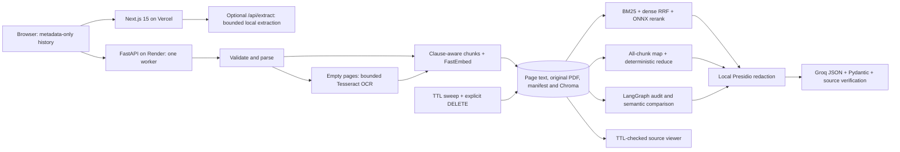
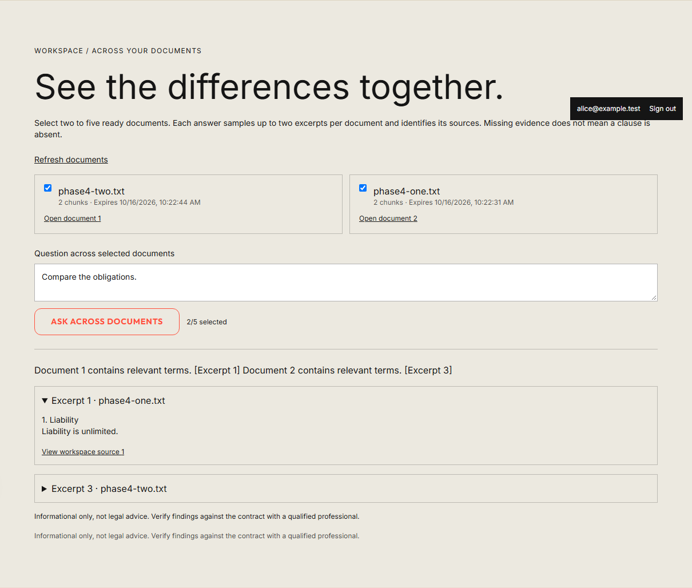
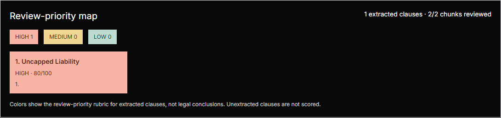
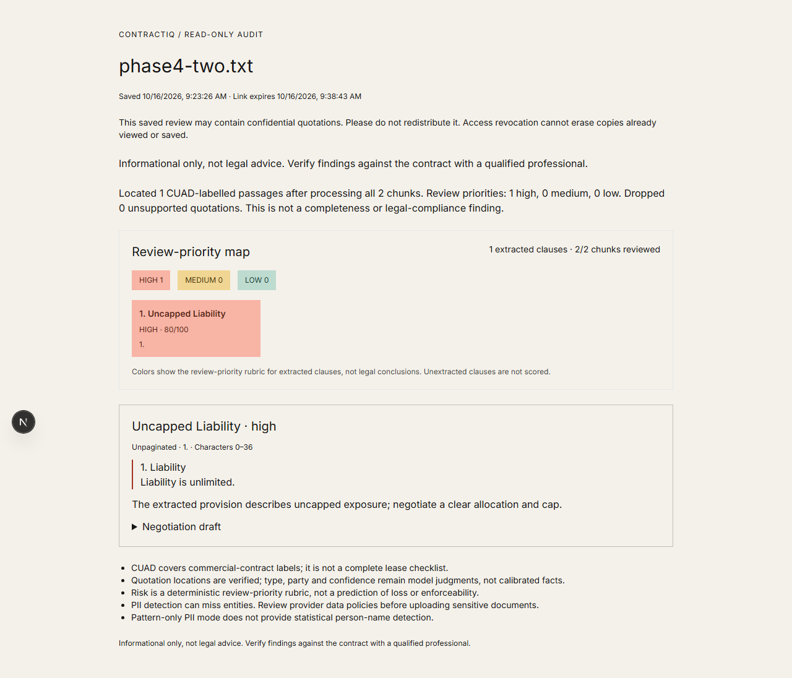
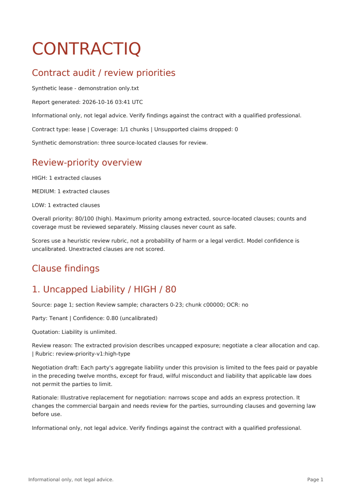

# ContractIQ

Explore property contracts through cited Q&A, clause audits, version comparison and a workspace for questions across documents. **Informational only, not legal advice.** Check findings against the original agreement and consult a qualified professional before making decisions.

Phases 0–4 are implemented. Phase 4 adds downloadable audit PDFs, expiring and revocable read-only audit links, a multi-document workspace, and a contract risk heatmap. See the [Phase 4 guide](docs/phase-4.md) and [recorded verification](docs/phase-4-verification.md). This is a tested portfolio application; hosted deployment and dependable legal extraction remain unverified.

Use `APP_MODE=production` with Supabase, Postgres/pgvector, private S3/R2 and Redis/RQ for shared deployments. The default `APP_MODE=local` is an unauthenticated development/evaluation mode: anyone holding a document ID can access it. Public audit sharing is disabled in local mode.

## Functionality

- Upload PDF, DOCX, UTF-8 TXT/MD or paste text. Default limits: 2 MiB, 60 PDF pages, 100,000 extracted characters, 120 chunks, 20 retained documents.
- Clause-aware splitting with section/page/character offsets and recursive fallback (1,000 characters / 150 overlap), local ONNX FastEmbed `sentence-transformers/all-MiniLM-L6-v2`, and cosine retrieval from Postgres/pgvector in production or Chroma in local mode.
- Configurable dense, BM25+dense/RRF, or hybrid+ONNX cross-encoder retrieval (default). Four final excerpts feed Groq `openai/gpt-oss-20b`. REST/audits use strict structured output; SSE chat uses JSON-object mode with Pydantic/citation validation, clearly marked drafts and a validated final response.
- Benefits analysis maps **every** chunk in bounded batches, checks quoted evidence, then deterministically merges duplicate party/kind/quotation findings. No keyword/top-five sampling or lossy LLM reduction. A failed batch fails the whole request; partial results are never reported as complete.
- All parties and benefits remain visible. Benefit significance scores (1–10) are model-generated and uncalibrated. The separate audit provides an explicit review-priority rubric; neither score measures fairness or enforceability.
- A LangGraph classify/checklist/extract/verify/summarize workflow extracts CUAD's 41 clause types over all chunks, drops unsupported quotations, computes review priorities and supplies illustrative negotiation drafts. Version comparison aligns extracted clauses and shows both sources and priority deltas.
- PDF source viewer with text/word-box highlights, bounded Tesseract OCR for empty PDF pages, local Presidio redaction before provider calls, and an optional India lease checklist citing official sources. Detection, OCR, model interpretations and legal applicability remain fallible.
- A ready-document workspace supports questions over two to five selected contracts, with up to two retrieved excerpts per document and document-specific source links. It is a retrieval sample, not exhaustive comparison.
- Successful audits are saved server-side. Export the latest audit as a paginated PDF, or create a production-only read-only snapshot link for 15 minutes, one hour or one day, capped by source retention. Revoke all links for a document at any time.
- The heatmap shows extracted clause priorities, counts and coverage with text labels as well as colors. Missing clauses never count as safe. Scores are a transparent heuristic, not probabilities or legal verdicts.
- Byte/type/size validation, archive expansion checks, limits before multipart parsing, explicit CORS origins, generated request IDs, bounded rate limits, sanitized errors, periodic document expiry/deletion.
- Components/hooks/lib, a runtime-validated typed API client, and metadata-only history with migration that removes old stored contract text and obsolete API keys.

## Architecture



Private endpoints enforce ownership and retention before returning data. Public shares expose only the saved audit snapshot through a random capability, with expiry and revocation checks on every fetch. They do include quotations and filenames. The [architecture ADRs](docs/adr/0009-audit-sharing-and-workspace.md) explain the tradeoffs.

### Local-mode data flow

The production architecture uses authenticated browser requests, Postgres, S3/R2 and a separate RQ worker; see the [Phase 3 diagram](docs/phase-3.md).



The UI uploads once to FastAPI and polls queued ingestion in production. `/api/extract` remains a standalone local-mode text-extraction fallback; it is disabled when frontend authentication is configured.

## Local development setup

Use Node 22 and Python 3.12 (the Docker/CI version).

```bash
python -m venv .venv
# Windows PowerShell: .venv\Scripts\Activate.ps1
# macOS/Linux: source .venv/bin/activate
python -m pip install -r contractiq-backend/requirements-dev.txt
cd contractiq-backend
# Copy .env.example to .env and set GROQ_API_KEY.
uvicorn main:app --reload --port 8000
```

In another terminal, from the repository root:

```bash
npm ci
# Copy .env.example to .env.local.
npm run dev
```

Open `http://localhost:3000`. First ingestion/retrieval downloads embedding/reranking models unless cached. Requirements install the pinned small spaCy model. Install the Tesseract executable with English language data on PATH for local OCR; the Dockerfile supplies it on Linux. Unit/API tests require neither ONNX downloads nor Groq credentials. Use one Uvicorn worker: locks, rate limits, and admission control are process-local.

## Verification

```bash
# Repository root
npm run lint
npm run typecheck
npm test
npm run build

# Activated Python environment, backend directory
cd contractiq-backend
python -m ruff check .
python -m mypy
python -m pytest -q
```

Tests cover whole-document map coverage, deduplication, invalid/truncated model outputs and bounded retries, unsupported quotations, failed batches, upload spoofing, archive bombs, streamed limits, CORS, request IDs, rate limits, TTL/restart/failure cleanup, API flow with mocked Groq, history migration/expiry, failed deletion, stale async results, citations, and fallback extraction. Real Chroma persistence/retrieval/deletion is tested with deterministic vectors. GitHub Actions runs backend lint/typecheck/tests and frontend lint/typecheck/tests/build.

The [Phase 4 verification record](docs/phase-4-verification.md) separates software tests from AI-quality evidence. Measured retrieval results and the small infrastructure p95 smoke appear below; real generation p95, cost/document, memory fitness and legal accuracy are not established.

## Privacy and retention

In production, all original upload types are retained in private S3/R2 and extracted records/vectors in Postgres until TTL or deletion. Access is owner-filtered, including cached retrieval and source downloads. Delete tombstones access before physical cleanup; expired documents are inaccessible even when cleanup is delayed. Short signed PDF URLs remain bearer capabilities until expiry; object versions, backups and downloaded copies need separate retention controls. Browser history is account-scoped metadata, sessions are in memory, and optional fallback sends redacted excerpts to the configured second provider. Optional Langfuse/Sentry export allowlisted metadata, not contract text. See [Phase 3 retention details](docs/phase-3.md).

The following filesystem behavior applies to `APP_MODE=local`:

1. Upload bodies are bounded and parsed transiently; framework spools close after processing. Original PDFs are now retained for the source viewer; original DOCX/TXT files are not. OS temporary data can survive abrupt process/host crashes.
2. Canonical page text, OCR boxes and chunks/metadata persist in `DATA_DIR/documents/<uuid>/document.json`; original PDFs in `source.pdf`; embeddings in `vectors/`. **This is disk persistence, not zero persistence.** Default TTL: one hour from indexing start, including across restarts if the disk survives. The saved audit is `audit.json` in that same directory. All of these are inside the same deletion boundary.
3. Expired IDs are rejected immediately. A startup sweep and a 60-second periodic sweep remove the entire directory. Explicit deletion removes access before unlinking files. Failed filesystem deletion is logged without content and retried; explicit DELETE does not claim success while removal is pending. Cleanup cannot run on a suspended/stopped host and resumes on startup. Deletion is not forensic secure erasure and does not control host backups.
4. Browser storage retains only IDs, filenames, character/chunk counts, and creation/expiry times. Filenames can themselves be sensitive. Chat, quotations, scorecards, and pasted text stay in current-session memory. Loading this version removes old full-text history and HF/Groq keys; browsers that never load it cannot be migrated remotely.
5. Groq receives excerpts for chat, every chunk for benefits/audits, the question and up to six history messages after local Presidio replaces detected PII with reversible placeholders. Detection can miss information; no anonymity guarantee is made. Restoration maps stay in request memory. App TTL cannot remove provider-held data; review [Groq's data policy](https://console.groq.com/docs/your-data). The layout requests Google Fonts. Chroma telemetry and external LangGraph tracing are disabled; document bodies/provider responses are not logged by the app.
6. Legacy `chroma_db/` and `uploads/` folders have no TTL manifests and are not opened by this version. Before reusing an old disk, stop the old server and remove those legacy backend directories after verifying their resolved paths. Re-upload documents. The new sweeper only deletes its own UUID directories.

Saved audits contain source quotations and restored party information. Production shares store immutable copies and hashed tokens; deletion/expiry of the source blocks all share reads, and document deletion cascades to snapshots. Tokens travel in a URL fragment, are removed from the address bar after loading, and are POSTed in the read body. Anyone given the link can read and copy its audit. Revocation cannot erase viewed/downloaded copies. PDFs remain on the recipient’s device until they delete them.

Delete-all removes server documents represented by the last 10 remembered entries. The workspace lists up to 1,000 ready documents; opening one adds it to recent history for deletion. Older browser-history entries remain subject to their original backend TTL.

## Render + Vercel deployment

For an authenticated shared service, follow the [Phase 3 deployment steps](docs/phase-3.md): add managed Postgres/pgvector, Redis, a private bucket and an RQ worker; run the migration; configure Supabase in both API and frontend. The full infrastructure/model stack is not certified for a free/512 MiB tier. The instructions below describe the retained local-mode demo deployment.

Keep the two-service deployment. On Render use Docker with context `contractiq-backend` or the existing blueprint, set `GROQ_API_KEY`, and set `CORS_ORIGINS` to the exact frontend origin. Add preview origins individually; wildcard subdomains are rejected. Set Vercel's `NEXT_PUBLIC_RAG_API_URL` to the backend HTTPS URL. Keys belong only on the backend. Deploy frontend and backend together because `/benefits` now returns structured `items` instead of a JSON string.

Docker preloads the embedding/reranker models, installs the small NER model and Tesseract English, and starts one worker. `/health` is liveness only, not provider/model readiness. Configure Uvicorn proxy trust only for known proxy addresses; do not set `FORWARDED_ALLOW_IPS=*` on an exposed origin. Until trusted proxy addresses are configured, clients behind the same proxy may share a rate-limit bucket. CORS does not authenticate non-browser clients.

Free/low-memory suitability is a goal, **not a measured guarantee**. FastEmbed, the reranker and HNSW use one thread, and only one upload/chat/analysis job is admitted at a time. Chroma, ONNX, spaCy and OCR can exceed a small tier's memory. Lighter options are `RETRIEVER_STRATEGY=hybrid`, `PII_MODE=patterns` (weaker name coverage), `OCR_ENABLED=false`, and smaller `MAX_TEXT_CHARS`, `MAX_CHUNKS`, `MAX_DOCUMENTS`. Use a larger-memory tier for the full feature set if measurements require it. No PyTorch or sentence-transformers runtime is loaded.

Whole-document analysis can exceed free provider quotas or the 240-second budget. Failures are explicit rather than silently dropping chunks. Reduce document size; raise budgets only after checking hosting/provider limits. Browser timeout: 300 seconds, or 600 for comparison of two audits; host limits may be lower. No latency or memory numbers are asserted without measurements.

## Honest limitations

- Production features require correctly configured external services. Local mode remains unauthenticated. Inference admission is per API process, not a global distributed concurrency budget. Hosted identity, bucket policy, telemetry dashboards and a real second provider require deployment checks documented in [Phase 3 verification](docs/phase-3-verification.md).
- Format checks are not antivirus or a full parser sandbox. PDFs/OCR can still be resource-intensive. Backend DOCX extraction reads main paragraphs/tables, not separate footnotes/headers/text boxes.
- Supported quotations and citation IDs cannot establish truth or correct legal interpretation. Coverage counts processed chunks, not extraction recall. Case/whitespace-normalized exact dedupe can retain paraphrases and party aliases.
- PDF highlights depend on matching text-layer order or OCR word boxes; unmatched PDF passages fall back visibly to canonical extracted text. Character offsets describe extraction, not the original PDF's byte layout.
- Next.js is upgraded from 14 to 15.5.27 with React 19 because the old line is affected by an unpatched Windows RCE advisory. Render/Vercel and the App Router structure remain unchanged. [Maintainer advisory](https://github.com/vercel/next.js/security/advisories/GHSA-p293-qw3h-jr36). ESLint 8 and Tailwind 3 still use older tooling; remaining advisories are documented in the verification notes.

See [Phase 1 implementation and manual checklist](docs/phase-1.md) for API contracts, privacy changes, risk rubric, source references and deployment tradeoffs, and [Phase 1 verification](docs/phase-1-verification.md) for historical software checks.

## Evaluation

Phase 2 adds a pinned CUAD test subset and forty authored synthetic Q&A cases. Run `make eval` with the Python environment active, or `python -m evals.prepare` followed by `python -m evals.run` where Make is unavailable. The default run makes no LLM calls; generator/judge evaluation requires explicit `--online`. It compares recursive/clause-aware chunking with dense, hybrid and hybrid-plus-reranker retrieval, returning Hit@4, MRR@4 and span Recall@4. Provider-dependent scores remain null when not run.

Read the [evaluation guide](evals/README.md), [measured results](evals/results/phase-2-retrieval/results.md), [machine-readable evidence](evals/results/phase-2-retrieval/results.json), [live pilot and verification](docs/phase-2-verification.md) and [Phase 2 checklist](docs/phase-2.md). These are bounded development results, not a full CUAD benchmark, legal-correctness assessment or production resource measurement.

### Measured retrieval results

Phase 2 measured 94 answerable CUAD subset cases and 35 answerable authored golden cases. The golden set also contains five unanswerable cases. Values below are copied from the [saved harness output](evals/results/phase-2-retrieval/results.md); this is a bounded development subset, not full-CUAD performance.

| Chunking / retrieval | CUAD Hit@4 | CUAD MRR@4 | CUAD Recall@4 | Golden Hit@4 |
| --- | ---: | ---: | ---: | ---: |
| Recursive / dense | 0.4255 | 0.3067 | 0.3697 | 0.9714 |
| Recursive / hybrid | 0.5532 | 0.3936 | 0.4766 | 0.9714 |
| Recursive / hybrid + rerank | 0.5106 | 0.3794 | 0.4328 | 1.0000 |
| Clause-aware / dense | 0.4574 | 0.3156 | 0.3936 | 1.0000 |
| Clause-aware / hybrid | 0.5532 | 0.3918 | 0.4846 | 0.8286 |
| Clause-aware / hybrid + rerank | 0.5213 | 0.3723 | 0.4449 | 1.0000 |

The default reranker did not improve CUAD Hit@4 over hybrid in this run. The [live generation pilot](evals/results/provider-pilot/results.md) scored only **1 of 24 cases** (23 failed): that one case had faithfulness 0.5 and answer relevance 1.0. It is insufficient to judge reliable answer quality. The [extraction pilot](evals/results/extraction-pilot/results.md) returned precision, recall and F1 of **0** for one CUAD document (7 gold spans, 1 predicted span, 0 matches at the configured overlap threshold). These results need improvement before consequential use.

### Latency, cost and resource evidence

| Measure | Recorded result | Scope |
| --- | --- | --- |
| Aggregate request p95 | 410 ms | Phase 3 synthetic CRUD smoke: 2 users, 30-second target, 34 requests, 0 failures; rounded Locust statistic |
| Real provider generation p95 | Not measured | Browser tests use deterministic provider fixtures |
| Cost per document | Not measured | No complete production token/cost ledger; no estimate substituted |
| 512 MiB / free-tier fitness | Not established | Full ONNX, spaCy, OCR and database stack requires deployment measurement |

The [saved load results](docs/phase-3-load-smoke.json) include cleanup requests and no provider calls. They do not establish generation latency or production capacity. [Load instructions](load/README.md) and opt-in provider telemetry are available for deployment measurements; provide configured pricing before treating telemetry costs as authoritative.

## Screenshots and demo

Captured from the running app with synthetic documents and deterministic model fixtures. These illustrate software behavior, not real-model quality.






**Demo video placeholder:** recording not yet supplied. Suggested walkthrough: sign in, upload two synthetic contracts, ask a cross-document question, inspect a source, run an audit, export PDF, open a shared link in a guest browser, then revoke it.

Generate the synthetic PDF with `python scripts/sample_report.py` from an activated environment. It writes `output/pdf/contractiq-sample.pdf`; no private contract or provider call is used.
