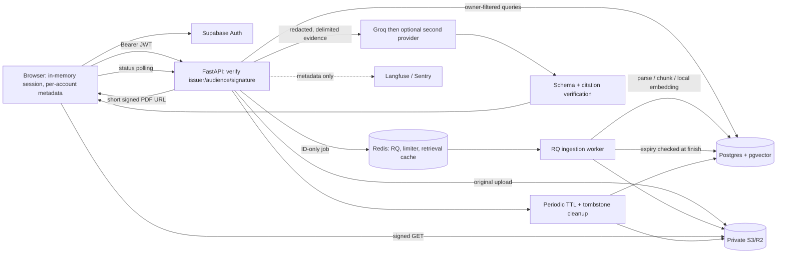

# Phase 3: Production engineering

Scope: authentication/isolation, durable storage, background ingestion, shared budgets/cache, provider fallback, injection defenses, observability, browser/load tests and deployment instructions. Phase 4 product features are not included.

The implemented plan adds backend auth/storage/queue/provider/telemetry modules and SQL, frontend session and upload polling, Compose, tests and ADRs. New pinned libraries are Supabase JS for identity; psycopg/pgvector SQL and boto3 for storage; Redis/RQ for jobs and budgets; PyJWT/cryptography for server verification; Langfuse/Sentry for opt-in observability; Playwright and isolated Locust tooling for validation. Tradeoffs: external identity setup, more infrastructure/memory, asynchronous failures, private cloud policies requiring deployment verification, and model fallback increasing vendor exposure/cost.



## Local production-shaped setup

Use Docker Compose v2 with optional env-file support. Copy `compose.env.example` to ignored `compose.env`, configure your Supabase project (asymmetric signing key, email/password enabled), publishable key and Groq key. Then:

```sh
docker compose --env-file compose.env up --build
```

Open `http://localhost:3000`, create/confirm a test account, then sign in. Public authentication values are baked into the web build. Compose binds web/API/data ports to loopback. The S3 emulator is disposable and non-authorizing; use only synthetic samples. It is not a cloud deployment template. Do not put a Supabase service-role key in a browser variable. Missing production backend settings fail at startup; missing required frontend auth settings fail closed.

`APP_MODE=local` preserves the unauthenticated file/Chroma development and evaluation path. Anyone holding a local-mode document ID can access it. Use production mode for a shared service. Existing local files are not auto-migrated; re-upload into an authenticated account.

## Deploy on Render + Vercel

1. Provision private Postgres with `vector` extension, Redis, and an S3/R2 bucket. Set the backend variables from `contractiq-backend/.env.example`, including `APP_MODE=production`. Use TLS/private networking and separate migration/runtime privileges. Do not use Compose's local passwords or Moto in deployment.
2. Run `python migrate.py` once with migration credentials; it serializes migrations using an advisory lock. Provision the bucket out of band. Run the backend Docker image as the API and a separate background worker with `rq worker --url "$REDIS_URL" --serializer rq.serializers.JSONSerializer ingestion`. Only trusted operators can write Redis jobs. API/worker must share database, bucket, Redis and embedding versions.
3. Configure `CORS_ORIGINS` to the exact Vercel/custom domain; set Vercel `NEXT_PUBLIC_AUTH_REQUIRED=true`, `NEXT_PUBLIC_SUPABASE_URL`, `NEXT_PUBLIC_SUPABASE_PUBLISHABLE_KEY`, `NEXT_PUBLIC_RAG_API_URL`; rebuild. The old standalone extraction endpoint returns 410 in authenticated deployments.
4. Use `/health` for liveness and `/ready` for database/Redis/bucket readiness. Readiness does not prove model/provider/Supabase availability. Configure trusted proxy IPs explicitly for IP rate limiting. Keep data services and credentials inaccessible to browsers.
5. Configure lifecycle/backup retention, alerting, supported second-provider model/pricing, and opt-in telemetry. Follow the checks below with disposable accounts before public access.

One inference operation per API process and one active job per worker are conservative defaults. The full stack has not been certified for a free/512 MiB tier. Managed Postgres/Redis/storage, a separate worker, `RETRIEVER_STRATEGY=hybrid`, `PII_MODE=patterns` (weaker name coverage), `OCR_ENABLED=false` and smaller document bounds reduce resource demand; measure before choosing a tier.

## Verification commands

```sh
python -m pip install -r contractiq-backend/requirements-dev.txt
npm ci
docker compose up -d --wait postgres redis s3
# Windows: $env:RUN_INFRA_TESTS='1'
RUN_INFRA_TESTS=1 python -m pytest contractiq-backend/tests -q
python -m ruff check contractiq-backend e2e load
cd contractiq-backend
python -m mypy
cd ..
python -m pytest evals/tests -q
npm run lint
npm run typecheck
npm test
npm run build
npx playwright install chromium
npm run test:e2e
```

PowerShell infrastructure test invocation (after starting the three data services):

```powershell
$env:RUN_INFRA_TESTS='1'
.\.venv\Scripts\python.exe -m pytest contractiq-backend/tests -q
```

Browser tests use isolated schemas/buckets/queues, signed synthetic tokens, real RQ and deterministic test vectors/AI. They do not validate hosted Supabase email delivery, real model quality, cloud bucket policy or Linux worker process termination. Native OCR tests require Tesseract. [Load-test commands and scope](../load/README.md); [recorded verification](phase-3-verification.md); [architecture decisions](adr/0004-production-auth-and-data.md).

To exercise the normal Linux RQ worker with real local embeddings after building and starting the local Compose stack, run:

```powershell
Get-Content -Raw e2e/docker_smoke.py | docker compose exec -T api python -
```

On a POSIX shell, use `docker compose exec -T api python - < e2e/docker_smoke.py`. This creates a synthetic TXT upload under a random owner, waits for ingestion, searches its vectors, and deletes the document. It makes no provider calls. Run it only against the private local test stack; it accesses the repository directly and does not exercise HTTP authentication.

The final frontend suite was also run inside the built Linux image. Use a disposable container; the test-only root user permits Vite to write its temporary cache, while the normal web service runs as `node`:

```sh
docker create --name contractiq-frontend-tests --user 0 -e NODE_ENV=test -e NEXT_PUBLIC_AUTH_REQUIRED=false -e NEXT_PUBLIC_SUPABASE_URL= -e NEXT_PUBLIC_SUPABASE_PUBLISHABLE_KEY= contractiq-web:latest node node_modules/vitest/vitest.mjs run
docker cp vitest.config.mts contractiq-frontend-tests:/app/vitest.config.mts
docker start -a contractiq-frontend-tests
docker inspect contractiq-frontend-tests --format '{{.State.ExitCode}}'
docker rm contractiq-frontend-tests
```

Expect 35 passing tests and exit code 0. Stop the local stack with `docker compose stop` when finished; this preserves images and database/Redis volumes.

## Manual deployment checklist

- Sign in as account A, upload a synthetic PDF, observe processing/ready, chat, open source and request `/document/{id}/download`. Verify the actual cloud URL expires and the bucket rejects unsigned requests.
- Sign out and sign in as B. A's history/answer is absent; A's document/source/PDF/status/analysis/delete endpoints return 404 with B's token. Missing/expired/wrong-project tokens return 401.
- Delete A's file; verify metadata/source/cache reads fail and the original is removed. Repeat with temporary object-store failure and confirm tombstone cleanup. Check expiry while a worker is active.
- Stop a worker: queued uploads must time out explicitly. Stop Redis: new authenticated requests fail closed, not bypass budgets. Confirm shared rate limiting across API replicas.
- Use synthetic injection text and invalid provider responses. Confirm source checks reject unsupported output and no HTML executes. Test the configured second provider before enabling fallback for real data.
- Enable test telemetry, inspect request correlation/usage/latency and configured cost inference, and confirm no document text, tokens or filenames appear. Review infrastructure logs separately.

Retention starts when upload is reserved. All original file types, extracted text and vectors persist until deletion/expiry; failed uploads also expire. Browser history stores per-account metadata (including potentially sensitive filenames), never contracts/tokens. Provider calls send locally redacted evidence, but detectors can miss data. Optional fallback sends evidence to another configured vendor. Physical deletion, object versions, backups and already downloaded copies have distinct retention controls.
